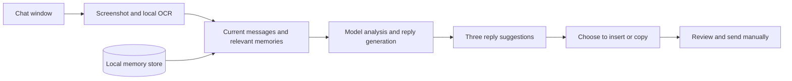

<div align="center">

# Witty

**[简体中文](README.md) · English**

### Remembers the context. Helps you find the words.

An AI reply assistant for WeChat on Windows · Local memory retrieval · Three suggestions · One-click insertion

[](https://github.com/lulululala-77/Witty/stargazers)
[](https://github.com/lulululala-77/Witty/forks)


**[Features](#features) · [How it works](#workflow) · [Tech stack](#tech-stack) · [Getting started](#start) · [Privacy](#privacy) · [Acknowledgments](#credits)**

<sub>记得聊过什么，也帮你想好怎么回。</sub>

</div>

---

> **A little more context before you reply.** A friend's preferences, a colleague's ongoing project, and your own communication style can all shape what you say next. Witty retrieves relevant memories to help you draft a reply that fits the conversation.

> **Currently a Windows pilot project.** Review and edit suggestions before using them. Inserting a reply does not send it—you stay in control. This document describes the development version; features in a published version depend on its corresponding commit.

<a id="features"></a>
## ✨ What Witty does

| Feature | What it helps you do |
| :--- | :--- |
| **Read the current conversation** | Extract messages from chat-window screenshots using local OCR, reducing manual copying. |
| **Retrieve relevant memories** | Bring in locally stored context about contacts, situations, and personal preferences. |
| **Offer three suggestions** | Draft replies using the current messages and retrieved context so you can compare alternatives. |
| **Insert or copy** | Insert a suggestion into the chat input, or copy it to use yourself. |
| **Keep you in control** | Edit, ignore, or pause the assistant. Witty never clicks Send for you. |

<a id="workflow"></a>
## 🧭 From message to reply



Local OCR and storage do not make the entire workflow offline. Generating replies calls your configured model provider. Relevant chat text and retrieved context may be included in those requests.

<a id="tech-stack"></a>
## 🛠️ Tech stack

| Component | Technology | Purpose |
| :--- | :--- | :--- |
| Runtime | Python 3.11 / 3.12 · Windows 10 / 11 | Desktop application and background processing |
| Desktop UI | PySide6 (Qt) · PySide6-Fluent-Widgets | Overlay, reply suggestions and settings |
| Window capture | windows-capture · NumPy | Capture windows through Windows Graphics Capture and process images |
| Local OCR | RapidOCR · ONNX Runtime · Windows.Media.Ocr (winsdk) | Extract chat text; Windows OCR adds Korean and Japanese recognition |
| Local memory and retrieval | SQLite · Sentence Transformers · BAAI/bge-small-zh-v1.5 | Store memories, embed text and retrieve relevant context |
| Embedding service | Python http.server · Local HTTP | Run the embedding model in a separate service for the desktop app |
| Model integration | OpenAI SDK · Anthropic SDK · Google GenAI SDK · TypeSafe SDK | Connect to configured providers for analysis and reply generation |
| Pilot analytics | PostHog | Optional usage analytics, disabled by default |
| Windows packaging | PyInstaller | Build the desktop executable |

<a id="start"></a>
## 🚀 Getting started

### Run from source

You need Windows 10 / 11, Python 3.11 or 3.12, and API keys for your chosen model services. Model providers may charge for API usage.

Open PowerShell in the project directory:

```powershell
python -m venv .venv
.\.venv\Scripts\python.exe -m pip install -r requirements.txt
```

For local vector retrieval, start the embedding service and leave the terminal running. The first launch may download a model:

```powershell
.\.venv\Scripts\python.exe embedding_server.py
```

Open another PowerShell window in the same directory and start the assistant:

```powershell
.\.venv\Scripts\python.exe main.py
```

Configure model services and relationship settings, open a WeChat conversation, and try generating, copying, and inserting replies. Use synthetic conversations for your first test.

### Everyday use

1. Open the conversation you want help with and keep the chat window available.
2. Wait for Witty to recognize the messages and offer three suggestions.
3. Insert or copy a suggestion, then adjust the wording to sound like you.
4. Check the content and recipient before sending it yourself.

<a id="privacy"></a>
## 🔒 Privacy and pilot analytics

- **OCR runs locally.** Reply generation uses your configured model services. Review their data-handling policies.
- **Memories are stored locally.** Do not commit chat memories, debug records, configuration, or API keys to a public repository.
- **Pilot analytics are off by default.** If you opt in, usage events track suggestion exposure, insertion clicks, copying, and generation latency. These events do not upload chat text.
- **Analytics have limits.** Completing an insertion action does not confirm that text reached the input field or that a message was sent.

## 🧪 Current limitations

OCR, conversation detection, and insertion behavior depend on window state, display scaling, and chat-app versions. Memory retrieval may miss useful context or return unrelated information. Treat suggestions as drafts, and check names, facts, commitments, and tone.

This repository currently targets Windows. Android and iOS support have not been implemented here.

## 💬 Feedback and contributions

Share problems and suggestions through [Issues](https://github.com/lulululala-77/Witty/issues). Include your system version, reproduction steps, and expected versus actual behavior. Redact private information from screenshots, and never upload API keys or real chat databases.

<a id="credits"></a>
## 🤝 Origins and acknowledgments

Witty is based on [jev-chat-windows](https://github.com/jev-chat/jev-chat-windows), whose decision engine originates from [jev-chat-jarvis](https://github.com/jev-chat/jev-chat-jarvis). Thank you to the original authors and contributors for their foundational work.

Original copyright and license notices are preserved in [LICENSE](LICENSE) and [NOTICE](NOTICE). Review the repository's own license separately from those of its dependencies. The project includes dependencies such as PySide6-Fluent-Widgets; the repository's MIT license alone does not establish the licensing terms for an entire distribution bundle.

Witty is an independent derivative project. It is not produced, partnered with, or endorsed by the upstream authors or WeChat.

---

<div align="center">

**More context for your replies. The final choice stays yours.**

[Back to top](#witty)

</div>
