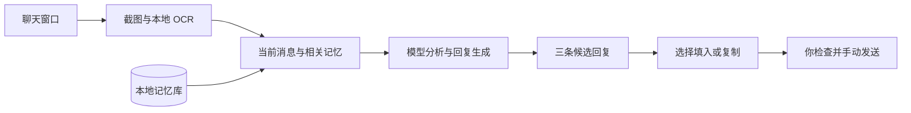

<div align="center">

# Witty

**简体中文 · [English](README.en.md)**

### 记得聊过什么，也帮你想好怎么回。

Windows 微信 AI 回复助手 · 本地记忆检索 · 三条候选 · 一键填入

[](https://github.com/lulululala-77/Witty/stargazers)
[](https://github.com/lulululala-77/Witty/forks)


**[功能介绍](#features) · [工作流程](#workflow) · [开始使用](#start) · [隐私与统计](#privacy) · [项目来源](#credits)**

<sub>Remembers the context. Helps you find the words.</sub>

</div>

---

> **回复之前，多一点上下文。** 朋友之前提过的偏好、同事正在推进的事情、你习惯的表达方式，都可能影响这一句该怎么回。Witty 尝试把相关记忆带回当前对话，让回复更贴近你的处境。

> **当前为 Windows 内测项目。** 候选回复需要你自行判断和修改；点击填入后，发送仍由你决定。本文介绍当前开发版本，已发布版本的能力以对应提交为准。

<a id="features"></a>
## ✨ Witty 能帮你做什么

| 能力 | 使用体验 |
| :--- | :--- |
| **读取当前对话** | 通过聊天窗口截图和本地 OCR 提取消息，减少手动复制。 |
| **带上相关记忆** | 检索联系人、场景和个人偏好相关的本地记忆，为回复提供背景。 |
| **提供三条候选** | 结合当前消息与检索结果起草回复，帮助你比较表达方式。 |
| **填入或复制** | 选择合适的候选填入聊天框，或复制后自行使用。 |
| **保留最终决定权** | 可以修改、忽略或暂停助手；程序不替你点击发送。 |

<a id="workflow"></a>
## 🧭 从消息到回复



本地 OCR 和记忆存储不等于全程离线：生成回复时，需要调用你配置的模型服务。相关聊天文本和检索背景可能随请求发送给该服务商。

<a id="start"></a>
## 🚀 开始使用

### 源码运行

准备 Windows 10 / 11、Python 3.11 或 3.12，以及所选模型服务的 API Key。模型调用可能产生服务商费用。

在项目目录打开 PowerShell：

```powershell
python -m venv .venv
.\.venv\Scripts\python.exe -m pip install -r requirements.txt
```

使用本地向量检索时，先启动 embedding 服务并保持终端运行。首次启动可能需要下载模型：

```powershell
.\.venv\Scripts\python.exe embedding_server.py
```

另开一个 PowerShell 窗口，进入同一目录后启动助手：

```powershell
.\.venv\Scripts\python.exe main.py
```

在设置中配置模型服务与关系信息，打开微信聊天窗口，再体验生成、复制和填入。首次验证建议使用合成对话。

### 日常使用

1. 打开需要辅助的聊天会话，保持聊天窗口可用。
2. 等待 Witty 识别消息并给出三条候选。
3. 选择一条填入或复制，按自己的习惯修改措辞。
4. 检查内容与发送对象，再由自己发送。

<a id="privacy"></a>
## 🔒 隐私与内测统计

- **截图识别在本地进行。** 回复生成会使用配置的模型服务，请确认其数据处理规则。
- **记忆保存在本地。** 聊天记忆、调试记录、配置和 API Key 不应提交到公开仓库。
- **内测统计默认关闭。** 主动开启后，上报功能使用事件，用于观察曝光、填入点击、复制和生成耗时，不上传聊天正文。
- **统计有明确边界。** 填入动作执行完成不代表文字实际填入成功，也不代表消息已发送。

## 🧪 当前边界

OCR、会话识别和填入行为受窗口状态、系统缩放及聊天软件版本影响。记忆检索也可能遗漏背景或召回不相关内容。请把候选当作参考，尤其留意姓名、事实、承诺和语气。

目前本仓库面向 Windows；Android 和 iOS 适配尚不属于本仓库已完成的能力。

## 💬 反馈与贡献

欢迎通过 [Issues](https://github.com/lulululala-77/Witty/issues) 描述问题或建议。请提供系统版本、复现步骤、预期与实际表现。截图请遮盖私人内容，不要上传密钥或真实聊天数据库。

<a id="credits"></a>
## 🤝 项目来源与致谢

Witty 基于 [jev-chat-windows](https://github.com/jev-chat/jev-chat-windows) 二次开发，其判断内核源自 [jev-chat-jarvis](https://github.com/jev-chat/jev-chat-jarvis)。感谢原作者与贡献者提供的基础工作。

原始版权和许可声明保留在 [LICENSE](LICENSE) 与 [NOTICE](NOTICE)。仓库自身代码的许可与第三方组件许可需分别查看；本项目包含 PySide6-Fluent-Widgets 等依赖，不能仅凭仓库的 MIT 声明判断整个分发包的许可条件。

Witty 是独立的修改项目，不代表上游作者或微信官方出品、合作或背书。

---

<div align="center">

**让回复有上下文，让表达保留你的选择。**

[回到顶部](#witty)

</div>
